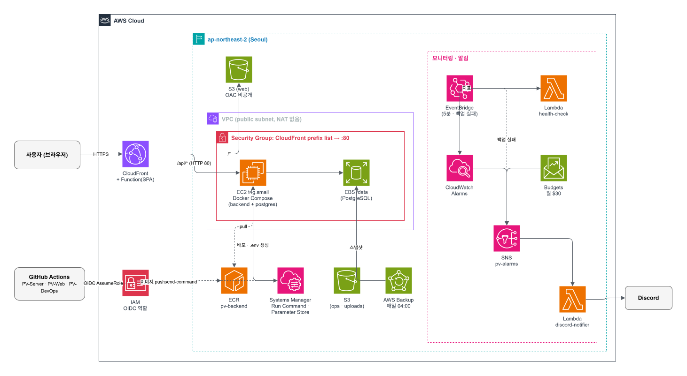

# PV-DevOps
동아리 팀 운영 서비스 **PV**의 AWS 인프라(Terraform)와 운영 문서입니다.

## Architecture


| 구분 | 사용 기술 |
| --- | --- |
| IaC | Terraform (S3 backend, native lock) |
| CI/CD | GitHub Actions, OIDC, ECR, SSM Run Command |
| 런타임 | EC2(ARM), Docker Compose |
| 배포·저장 | CloudFront, S3, EBS, AWS Backup |
| 모니터링 | CloudWatch, EventBridge, SNS, Lambda, Budgets |
| 시크릿 | SSM Parameter Store (SecureString) |

## Repository

```
bootstrap/     # Terraform state 버킷 (최초 1회)
modules/       # AWS 서비스 단위 모듈
functions/     # Lambda 소스 (헬스체크, Discord 알림)
main.tf        # 모듈 연결
providers.tf   # provider 버전, backend
```

## Infra 변경

```bash
git switch -c feat/<작업>
terraform fmt -recursive && terraform plan
# PR 생성 → CI plan 댓글 확인 → Squash merge
git switch main && git pull && terraform apply
```

- `main`은 PR과 CI 통과가 필수입니다.
- apply는 관리자 권한이 필요해서 CI가 아닌 로컬에서 실행합니다.
- PR의 plan과 로컬 plan이 다르면 apply하지 않습니다.

## Operations
**서버 접속:** SSH는 사용하지 않습니다. AWS 콘솔 → EC2 → 연결 → Session Manager

```bash
cd /data/backend
sudo docker compose ps
sudo docker compose logs --tail 100 backend
```

**수동 롤백:** 이전 커밋 SHA의 이미지로 다시 배포합니다.

```bash
MSYS_NO_PATHCONV=1 aws ssm send-command \
  --document-name pv-deploy \
  --instance-ids <INSTANCE_ID> \
  --parameters tag=<이전 커밋 SHA>
```

**시크릿 변경:** 다음 배포 때 서버 `.env`에 반영됩니다.

```bash
MSYS_NO_PATHCONV=1 aws ssm put-parameter \
  --name /pv/backend/<KEY> --type SecureString --value '<VALUE>' --overwrite
```

## Security

- GitHub Actions는 OIDC로 인증하며, 장기 Access Key를 쓰지 않습니다.
- 배포 역할은 지정한 SSM 문서만 실행할 수 있고, PR plan 역할은 읽기 전용입니다.
- EC2는 CloudFront IP 대역에서 오는 80번 포트만 허용하고, IMDSv2를 강제합니다.
- 시크릿 값은 Terraform 코드와 state에 남기지 않습니다.
- 서드파티 Actions는 커밋 SHA로 고정합니다.

## Monitoring

| 이벤트 | 대응 |
| --- | --- |
| EC2 상태 검사 실패 | 자동 복구 / 재부팅 + 알림 |
| 웹·API 헬스체크 2회 연속 실패 | 알림 |
| CPU 과부하 · 크레딧 부족 | 알림 |
| 백업 실패 | 알림 |
| 월 예산 80%(실제) · 100%(예상) | 알림 |

모든 알림은 Discord로 전송됩니다.